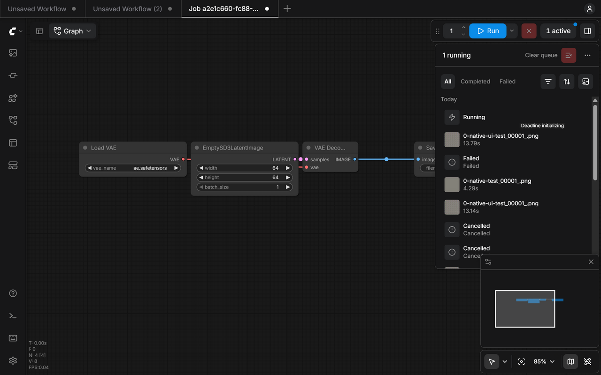

# Native queue validation — 2026-10-06

## User test recovery and lifecycle fixes — 2026-10-07

The four MiniMax video tests completed on m21, M23, SIM01 and M25. The submitting host repeatedly read an unlinked, generation-zero SMB record after remote atomic replacement. This hid Worker/progress information, falsely reported successful jobs as failed, and allowed cancellation to overwrite newer attempt metadata. A read with DELETE access alone, and an unbuffered read allowing sharing, both failed repeated two-host validation. Brief exclusive, unbuffered UNC reads passed 30 successive publications from SIM01 to M28; cancellation preserved the current generation/assignment and rejected a late result commit. Evidence is retained under the ignored `work/smb-freshness-config.json` and its isolated NAS validation folder.

All four accepted result pointers and twelve output hashes were verified. The four MP4s also passed size/hash checks when fetched through ComfyUI's native asset URLs. Nine earlier Deadline jobs were confirmed deleted and reconciled to cancelled history without resubmission. The live browser showed zero active jobs, four completed runs and nine cancelled runs. Evidence: `work/lifecycle-recovery-verified.json`.

132 Python tests and 41 JavaScript tests pass. Regressions cover explicit missing-job confirmation versus repository outages, result/attempt fencing, old progress rejection, cancellation event ordering, lost activation followed by deletion or failure, and storage changes after confirmed removal. Windows reads cover BOMs, exact 64 KiB boundaries and larger records. Seven DOM checks cover Stop placement, virtual row reuse, Stopping, settled renders, terminal cleanup and local-row isolation. A fresh isolated cold run was stopped through its native row and reached Cancelled with both task-owned processes exited; evidence: `work/lifecycle-stop-test.json`. The QA run was hidden after verification, preserving its shared records.

The idle artist was restarted through Manager to load these fixes, retaining port 8188 and GPU 1. Only the private NAS02 plugin's shared protocol helper was updated; production repository files and farm Worker settings were unchanged. The additional Opus 5.5 review attempt was rate limited. Read-only code review guided the missing-job fences, cancellation events and Stop DOM fixes.

## Current revision after Opus 5.5 review — 2026-10-07

The sidebar now contains destination (pool/group), priority, and More options for timeout and an optional Worker restriction. Changes save automatically. Machine installation, shared-storage/identity forms, enable toggle and Apply/Revert are removed from the artist interface. The local installer API and farm-mutating setup code are deleted. Normal tasks use existing Worker installation/GPU affinity without a persistent owner. Warm owners remain optional administration.

124 Python tests and 40 JavaScript tests passed after review fixes. New tests cover cold-owner affinity, PID rejection, task-owner cleanup after broker failure, Worker backend isolation, task-derived startup budgets, immediate missing-plugin errors, unrestricted jobs, real Deadline ownership independent of history scope, existing Workers without mappings, atomic execution-mode claims, cancellation winning over late startup failures, and avoiding control commands for missing or already stopped jobs.

Live sidebar run `33c63a5c-13cf-4631-9fe3-5f47a2fe972b` / Deadline job `6ac576cd961826ce29de4037` completed on the isolated local test Worker with its persistent owner stopped/disabled and its session mapping absent. A task-owned supervisor launched ComfyUI on GPU 0; startup took 45.125 seconds. The accepted PNG is 64 × 64, RGB (51,119,187), hash verified and available through native Jobs assets. Supervisor PID 54536 and GPU child PID 25072 both exited after completion. Deadline recorded the real user `dominik.bargiel`. Evidence: ignored `work/unslop-cold-render.json`.

The missing-node cold test `e8a7ef0b-c3f7-45ca-bc6b-c6c0d0863fb7` / Deadline job `6ac578db120b5077e2f06dc2` reached Deadline Failed after three assignments. Each attempt released its owned processes; no result was committed. Evidence: `work/unslop-cold-failure-cancel.json`.

Fresh startup cancellation `8ec52c3a-e75e-4434-96d4-e5c5bffb8fd4` / job `6ac57b1a0f12eb2d77330bd2` automatically reached Cancelled in durable control and native Jobs, committed no result, and released supervisor PID 34204 and child PID 23076. The merged queue was empty afterward. Evidence: `work/unslop-cold-cancel-fixed.json`. Earlier cancellation exposed missing terminal reconciliation and a late startup transport error overwriting cancellation. Those were fixed and covered by regression tests; the original stuck test record was repaired only after proving its Deadline task stopped and processes exited, and is explicitly recorded as an operator repair rather than live proof of the fix.

Live browser checks confirmed autosave (50 → 51 → 50), Run gating while saving, selection retained during search, no artist setup forms, visible custom-plugin override, and a 312 px sidebar with a 57.5 px footer. T3 captured an earlier screenshot, but final snapshot calls failed; the final inline visual uses the actual live sidebar DOM and production stylesheet and is labelled as a DOM capture. Testing used a separate blank workflow; the original ten-node graph and tracked workflow state were retained and the test workflow was closed.

Only the existing isolated test Worker and private NAS02 plugin were changed for this verification. The private plugin pins the local portable4 installation for isolation. Production source still resolves Deadline's ComfyUIPath; the repository plugin and original farm Workers were untouched. Production rollout requires deploying the updated helpers and configuring NativeQueueRoot. Reservation is not implemented; optional warmth does not reserve Workers.

## Previous sidebar and local setup (superseded)

The sidebar now separates **Workers** and **Setup**, filters candidates by both pool and group, keeps invalid selections visible, and shows the full farm only when explicitly requested. The verified 312 px panel has one scrolling region and a 55.5 px normal footer. Draft settings block Run until Apply or Revert; backend readiness gates submission independently of the UI.

Final review also added durable-record checks before changing storage or updating setup, including lost activation responses and a restarted backend with no cache. New captures and background receipt recovery cannot race that check. Distributed collector/upscaler workflows are rejected before their browser dispatcher; explicit local Distributed Run keeps its existing behavior.

The final suite passes **138 Python tests and 48 JavaScript tests**. It includes restricted Worker user-scope eligibility, unknown scheduling modes, correction of never-initialized roots, inaccessible-share preservation, and settings/receipt concurrency regressions. The intentional existing synthetic queue-failure traceback remains expected.

The actual Setup action on port 8188 created **M28-ComfyUI-GPU0** with an owned GPU-0 session, the `test` pool, `comfy` group, and the isolated `dominik.bargiel-comfy` scope. Storage is `\\NAS02\Comfy\playground\deadline-native-queue`; its private plugin lives under `plugin\ComfyUI`. The repository's production ComfyUI plugin and existing farm Workers were not changed. The two limited interactive scheduled tasks remain installed as the usable local destination.

Clicking the sidebar's **Run on Deadline** queued run `1165f5b7-540c-43ad-89b9-e3740c52b15c` through the native Run controls. Its EmptyImage/SaveImage workflow completed on the dedicated Worker. The accepted PNG is 64 x 64, has the expected RGB pixel `(136, 85, 204)`, and matches its result-manifest hash. The native Jobs assets endpoint serves the result. After completion the owner had no child PID and no reservation. Evidence is `work/final-sidebar-render.json`.

Sixteen additional real-browser checks covered relevant Worker filtering, compact footer, hidden clean draft actions, draft gating, refresh/Revert, retained out-of-group selections, explicit entire-farm discovery, actual storage verification, and final reload/restoration. Evidence is `work/final-sidebar-browser-checks.json`. The browser's original ten-node workflow, positions, connections, and widget values were verified restored; the review-created duplicate tab was closed. After the final backend restart the completed run and its assets were recovered, readiness remained true, and a real API request using a disallowed Worker scope returned HTTP 400 without changing saved settings. T3 evaluate worked; snapshot calls repeatedly returned `PreviewAutomationExecutionError`, so a new live browser screenshot is not claimed. The inline preview is a read-only rendering of the verified sidebar DOM and its production stylesheet.

The sections below retain earlier implementation evidence and validation history; their historical process IDs, counts, and UI descriptions do not describe the current sidebar.

## Earlier implementation evidence

Implementation is present in this checkout, uncommitted. Native mode remains opt-in. All execution tests ran on **M28**, using a restricted test user and the `test` pool. A temporary second Deadline Worker on M28 exercised GPU 1 through the borrowed artist endpoint. **SIM01 was used only for the two-host SMB probe**, with no ComfyUI plugin synchronization or GPU-job interruption there.

Baseline: plugin `e87701a` / 1.0.10; Distributed `62c81b1`; ComfyUI 0.39.0; frontend 1.53.10; Deadline 10.4.2.2. The artist on port 8188, PID 17284, remained alive throughout the final tests. Source changes are confined to this plugin. Core status also shows a deleted runtime output placeholder; no core/frontend/Distributed source was edited.

## Automated evidence

**78 Python tests and 9 JavaScript tests pass.** This includes the original 30 regressions. Coverage includes merged native API filtering/pagination, local pass-through, bounded finite batches, resolved seeds, interleaved request routing, captured API wrappers, recursive/partial submission rejection, response/activation loss, idempotency, scope/settings checks, exact retry, output-cache rebuild, cancellation/result races, duplicate callbacks, stale assignments down to one .NET tick, safe asset paths, missing outputs, task timeout, disabled-mode retry rejection, actual execution-queue isolation, owned/borrowed drain rules, and Deadline-unavailable ownership preservation.

The intentional synthetic queue-failure traceback in the existing Python suite is expected. These tests use stubs where farm or browser failures must be controlled; their success is not presented as a live network failure test.

```powershell
& 'C:\AI\ComfyUI_windows_portable4\python_embeded\python.exe' -s -c "import sys,unittest;sys.path.insert(0,'.');r=unittest.TextTestRunner().run(unittest.defaultTestLoader.discover('tests'));sys.exit(not r.wasSuccessful())"
node --test tests/*.mjs
```

## Deadline sidebar revision

After the native queue gates, the configuration UI was moved to a dedicated public-API sidebar, following Distributed's registration pattern. The revised suite passes **83 Python tests and 14 JavaScript tests**, including discovery caching, stale-data retention, settings draft preservation, failed saves, aborted refreshes, and optimistic settings conflicts.

The isolated CPU ComfyUI on port 8197 passed **23 browser checks** against the actual frontend and repository. These cover registration, 80 discovered Workers, search, offline selection retention, Apply/Revert, draft preservation across refresh and reopening, validation failure, external edits detected during refresh, a concurrent-save HTTP 409, native Jobs opening, setup diagnostics, and layout at 240–420 px widths. The footer remained within both 800 px and 650 px viewports. Browser-generated evidence is retained at `work/sidebar-qa-final.json`; the opt-in harness is `work/sidebar_qa.js` and is outside production extension loading.

The Run bridge check temporarily supplied configured discovery metadata and intercepted the native Run click before execution; it proves delegation to native controls, not a new live GPU run or session-owner health check. All new farm discovery calls are read-only. T3 navigation and resizing worked; snapshot/evaluate calls failed, so no new sidebar screenshot is claimed. The main artist process (now PID 54004) remained running; only isolated CPU servers were restarted. Restart the artist normally and refresh its browser to load the new discovery/settings routes and sidebar. The isolated settings were restored and the test server stopped after verification.

## Live results

The follow-up live sidebar check restarted the idle artist through ComfyUI Manager to resolve a running-backend/browser-code mismatch. The discovery route on port 8188 then returned `connected=true`, repository `\\NAS01\repository`, 80 Workers, and five pools. The evidence is `work/sidebar-live-8188-discovery.json`. The artist kept port 8188 and GPU 1; Manager replaced PID 54004 with PID 55284. Native submission remained disabled and no jobs were submitted. Four additional JavaScript regression tests bring the total to **18**, covering the missing-route restart diagnostic and repository connectivity independent of submission enablement.

T3 browser inspection of the live sidebar confirmed **Connected**, `0 selected · 80 in farm`, and the actual repository pool choices. A saved capture is `docs/images/deadline-sidebar-connected.png`. The native plugin deployment warning remains visible separately from the successful repository connection.

Evidence is retained under `\\NAS02\Comfy\playground\deadline-native-queue-tests`:

| Gate | Observation | Evidence beneath that root |
| --- | --- | --- |
| Two-host SMB | M28/SIM01 mutually excluded writers; 2,370 unlocked atomic reads; remote process death released its lock; stale publication rejected | `storage-20261006-5/validation.json` |
| Three independent jobs, warm owned session | One supervised PID 48564 / session `bb574cfd-c022-4c66-82ad-db6e1424470c` across three Deadline sandboxes; task times 10.688, 0.188, 0.219 seconds; model loaded once | `sessions-20261006-3` and `direct-sessions-20261006` |
| Targeted interrupt and owner death | Only the reserved prompt was interrupted; owner death removed owned child 49448; replacement owner could start another child; artist identity preserved | `session-recovery-20261006/validation.json` |
| Durable acceptance and restart | Three accepted jobs completed after isolated submitting ComfyUI PID 30268 was killed; restarted submitter recovered results and served `/view` | `durable-20261006-4/validation.json` |
| Five native Run batch items on two GPU Workers | All five were accepted before submitter PID 33004 was killed; GPU 0 owned session rendered two, GPU 1 borrowed endpoint rendered three; five distinct valid results | `durable-20261006-4/two-workers-validation.json` |
| Stop and exact retry | Pending Stop never rendered; running Stop targeted its own Worker prompt and committed no result; retry retained the source prompt and duplicate request key returned the same new run | `durable-20261006-4/controls-validation.json` |
| Shared Worker GPU handoff | Owned session had no PID/reservation before task completion; borrowed artist survived | `durable-20261006-4/controls-validation.json` |
| Worker killed mid-render | Second GPU Worker completed generation 2 with eight files; a late generation-1 publication returned false and left the accepted pointer unchanged | `durable-20261006-4/worker-crash-validation.json` |
| Native output reuse | Add to current workflow created an annotated LoadImage; normal local Run completed; staged farm LoadImage/SaveImage round trip preserved image pixels. Fresh copied helper verified exact task-start ticks before commit | `durable-20261006-4/final-roundtrip-validation.json` |
| Native workflow and Retry | Open as workflow restored the readable graph; native context-menu Retry created `b5027c5c-1823-4b0e-82d6-00140168ed00`, which completed through the fresh helper | Same final-roundtrip report; source/new `submission.json` |
| Real sampler progress and preview | SDXL base, seed 777, 40 Euler steps at 384×384 completed. Observed 32 node-state samples and live JPEG previews with changing hashes; one accepted PNG | `durable-20261006-4/real-preview-validation.json` |
| Storage authority unavailable | Temporarily removing only the owned test store's sentinel retained all 17 cached jobs; submit returned 503 with a storage diagnostic; restoration reconnected | `durable-20261006-4/storage-outage-validation.json` |

Worker crash recovery used explicit Deadline requeue after the kill, rather than waiting for the repository's Worker-loss detection timeout. Both assignments were real Deadline assignments. The storage-outage gate injected a missing store identity; it did not disconnect the NAS or disrupt other users.

The M0 fixture was also exercised through the installed frontend: local plus remote statuses, readable workflow/output, Stop/retry, keyboard/dropdown focus, finite batch seeds 100/101/102, exact stored retry while widgets had advanced, two concurrent runs using the same node ID with different progress/previews, 209 pending rows across pagination, and reconnect. Fixture providers are loaded only by their explicit spike server.

An early Distributed wrapper bypass was found during M0; own accidental local prompts were targeted and removed/finished. Routing now marks the serialized request before captured API wrappers, and the Python `/prompt` guard rejects farm markers. No accepted production farm run enters the submitting instance's execution queue.

One T3 screenshot was saved and inspected. It shows the existing native Jobs panel with farm progress, completed outputs, and correctly labelled cancelled records:



Further screenshot calls intermittently failed with `PreviewAutomationExecutionError`; browser DOM/API observations and the saved screenshot are the evidence available. Screenshot failure is not recorded as a UI failure. After the real sampler finished, native `activeJobId` was null and global/per-job progress and preview state were empty.

## Corrections established by live tests

- Independent scheduled Worker/owner processes avoid the tool process's Windows process-tree restrictions.
- Portable Python uses `-s` to avoid an older user-site Torch stack shadowing the installation.
- Deadline's `CustomPluginDirectory` names the parent containing the plugin-name directory; copied helper imports explicitly add their sandbox directory.
- Windows temp-directory arguments need ComfyUI's appended `temp` subfolder accounted for.
- Native retained inputs use shallow deterministic content names; nested result references otherwise exceeded Deadline Python's Windows path limit.
- Owned sessions enable automatic sampler previews by default. Finished reservations remain held while Deadline is still publishing their results.
- Missing shared authority keeps cached history. Terminal progress has a newer sequence than its final live sample, so stale running previews clear.

## Validation limits and cleanup

Core/front-end compatibility is intentionally limited to the tested versions. Independent multi-browser configuration changes, every custom loader/output type, credential-dependent workflows, large-scale farm load, physical SMB cable loss, and the farm's automatic Worker-loss timing were not exhaustively exercised. Missing nodes/browser-interactive behavior, timeout, and missing output have automated negative coverage; they were not all repeated as live GPU failures. SDXL is a representative real sampler test, not an environment certification for every model.

The final cleanup record is `test-job-cleanup.json` at the evidence root. Completed/failed/suspended test jobs and off-host evidence are retained for review; no test job is left active. The temporary Worker is deleted, scheduled owners/probes are unregistered, and isolated test servers are stopped. The two test plugin directories were retired as `.disabled-native-20261006` backups beside the production plugin. Automatic approval review rejected their deletion and deletion of three inactive SIM01 Public probe files with a policy block; those small files are retained and have no scheduled task. M28's scheduling/user/concurrency/registration settings are restored. The production repository ComfyUI plugin was not overwritten, and the artist process was not restarted.

Use [the setup guide](DEADLINE_NATIVE_QUEUE.md) to deploy and enable native mode deliberately on the existing installation. No commit was created.
